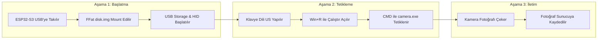

# 📷 ESP32-S3 Auto-Stealth Camera Payload

**Hardware-Enforced HID + USB Mass Storage Auto-Execution System**

## 📌 Özellikler

* 💾 **Kalıcı Dâhili Flash Bellek:** `FFat` dosya sistemi ile 2MB'lık sanal sürücü imajı (`disk.img`) oluşturur. Elektrik kesilse dahi `camera.exe` silinmez.

* ⌨️ **Otomatik Klavye Simülasyonu (HID):** Takıldığı bilgisayarda klavye dilini otomatik İngilizceye (US) çevirerek Türkçe Q klavyelerdeki karakter kayma sorununu çözer.

* 🚀 **Otomatik Sürücü Taraması:** Bilgisayardaki tüm sürücü harflerini (`D:` - `Z:`) hızlıca tarar, sanal USB bellek içindeki `camera.exe` dosyasını saniyeler içinde tetikler.

* 🌐 **Sessiz Sunucu Aktarımı:** Yakalanan kamera görüntülerini arka planda çalışan PHP sunucusuna HTTP POST isteği ile iletir.

## 🛠️ Donanım ve Yazılım Gereksinimleri

| Bileşen | Açıklama | 
| ----- | ----- | 
| **Geliştirme Kartı** | ESP32-S3-DevKitC-1 N16R8 (16MB Flash / 8MB PSRAM) | 
| **Bağlantı Portu** | Native USB (USB-OTG) | 
| **Yazılım Ortamı** | Arduino IDE (ESP32 Board Package v2.x+) | 
| **Sunucu Yanı** | PHP 7.4+ (CLI desteği olan herhangi bir cihaz) | 

## ⚙️ Arduino IDE Kart Ayarları

Kodu derlemeden önce Arduino IDE üzerinde aşağıdaki ayarların eksiksiz yapıldığından emin olun:

```text
Board: "ESP32S3 Dev Module"
USB Mode: "USB-OTG (TinyUSB)"       <-- Critical
USB CDC On Boot: "Enabled"
Flash Size: "16MB (128Mb)"
Partition Scheme: "16M Flash (3MB APP/9.9MB FATFS)"
PSRAM: "OPI PSRAM"
```

## 🚀 Adım Adım Kurulum ve Kullanım

### 1. ESP32-S3 Yüklemesi

1. `esp_camera.ino` dosyasını Arduino IDE ile açın.
2. Kartınızı **COM (UART)** portundan bilgisayara bağlayın ve kodu yükleyin.

### 2. Payload (`camera.exe`) Yüklemesi

1. Kod yüklendikten sonra kartı **Native USB** portundan bilgisayara takın.
2. Bilgisayarınızda `USB Storage` adında yeni bir çıkarılabilir disk belirecektir. *(Gerekirse Hızlı Biçimlendir yapın)*.
3. `camera.exe` dosyanızı bu sanal sürücünün içine kopyalayın.
4. Kartı bilgisayardan çıkarın.

### 3. Dinleyici PHP Sunucusunu Başlatma

Fotoğrafların toplanacağı uzak veya yerel sunucuda:

```bash
# 1. Proje dizinine gidin
cd /path/to/server

# 2. Görüntülerin kaydedileceği klasörü oluşturun
mkdir captures

# 3. PHP sunucusunu tüm ağ arayüzlerine açık başlatın
php -S 0.0.0.0:8080
```

## 🎯 Çalışma Mantığı (Execution Flow)



## 🤝 Katkıda Bulunma

1. Bu depoyu çatallayın (Fork).
2. Yeni bir özellik dalı oluşturun (`git checkout -b feature/YeniOzellik`).
3. Değişikliklerinizi işleyin (`git commit -m 'Yeni özellik eklendi'`).
4. Dalınıza itin (`git push origin feature/YeniOzellik`).
5. Bir Pull Request açın.